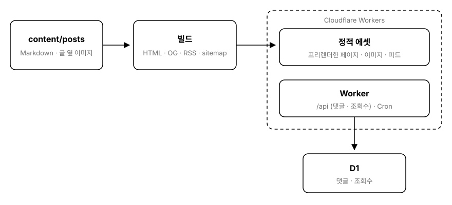
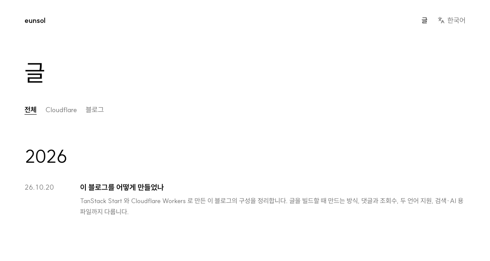

## What is this blog?

This is a personal blog built with TanStack Start and served from Cloudflare Workers.
Posts are written in Korean, and posts with an English translation are also available under `/en`.
Every post has comments and a view count.

I wiped the old Next.js + Supabase version and rebuilt the blog from scratch.
This post covers what I picked and how I put the pieces together.

> [!TIP]
> Want the big picture first? Jump to [Structure](/261020#structure).

## Structure



Posts and pages are generated as static files at build time.
The only thing the Worker handles per request is the comment and view count API.

| Role | Choice |
|---|---|
| Framework | TanStack Start |
| Hosting | Cloudflare Workers |
| Posts | Markdown + Content Collections |
| Data | Cloudflare D1 |
| i18n | Paraglide JS |
| Styling | Tailwind CSS |
| Font | SUIT |

I originally meant to use MDX.
But I didn't intend to put React components in posts, so I switched to plain Markdown.
For i18n, I compared Intlayer and a hand-rolled implementation before settling on Paraglide JS.

## Posts are turned into HTML at build time

Post pages and list pages are :term[prerendered]{key="prerender"}.
Cloudflare Workers blocks `eval` and `new Function`.
So Markdown isn't parsed on every request; it's turned into HTML at build time.

Each post is a folder.
The folder name is the URL, in the form `YYMMDD`.
The top of each post holds metadata like this:

```yaml
---
title: "How I built this blog with TanStack Start and Cloudflare Workers"
description: "The summary shown in search results (160 characters max)"
date: "2026-10-20 12:00"   # Korea Standard Time
tags: ["meta"]
---
```

:::details
What happens at build time

- Checks that the folder name (`YYMMDD`) matches the date and that no two posts share a date.
- Turns the body into HTML and highlights code blocks.
- Copies the images next to each post under hashed names and creates WebP versions.
- Checks that the English translation matches the original.
- Draws the OG image shown when the post is shared.
:::



Post data lives only on the server.
The JavaScript the browser downloads contains no post bodies.
That JavaScript is currently 128.9KB gzipped.

The only font is SUIT.
It is split into 94 chunks by character range, and a page downloads only the chunks for the characters it uses.


## Comments and view counts

Anyone can leave a comment with a name, a message, and a password.
The password is used to edit or delete the comment.

- Passwords are never stored in plain text. They are hashed with a salt, PBKDF2, and a server-only secret (a pepper).
- Spam is blocked with Cloudflare Turnstile.
- After five wrong passwords within 10 minutes, further attempts are blocked for a while.
- The blog owner is identified by signing in through Cloudflare Access, and their comments get a badge.

Each visitor is counted only once a day.
Reloading the page doesn't increase the number.
Visitors are told apart by hashing a daily salt together with the IP and browser info, and raw IPs are never stored.

Because the pages are built ahead of time, the browser fills in the counts and comments from the API.
Requests go out once :term[hydration]{key="hydration"} finishes, and a gray placeholder shows while they load.

## Written in two languages

Korean is the default, and English translations live under `/en`.
The only language pair right now is ko:en.
Posts without a translation don't appear in the English list.

Each English translation records a hash of the original.
If the original's body or title changes and the translation isn't updated, the build fails.
It's a safeguard so stale translations don't quietly linger.

## Files for search engines and AI

These files are generated at build time as well:

- `sitemap.xml`, `robots.txt`: `robots.txt` allows AI crawlers by name.
- RSS: one feed per language, with full post bodies.
- `llms.txt`, `llms-full.txt`: an AI-friendly post list and the full text of every post.
- Markdown source for each post: add `.md` to the post URL.
- OG images: a share card drawn for each post.

## What posts can include

On Korean pages, quotes can show the original alongside a translation; on English pages like this one, only the original appears.
This line is from Edsger W. Dijkstra's EWD498.

::::quote
:::translation
Simplicity is prerequisite for reliability.
:::
:::original
Simplicity is prerequisite for reliability.
:::
::::

Posts can also embed small widgets.
Try the button below.

:::widget-counter-demo
If widgets can't run in your environment, you'll see this sentence instead.
:::

## Wrapping up

This blog generates its posts and pages at build time, and only comments and view counts go through the Worker.
Posts are written in Markdown, and the build stops when an English translation drifts from the original.
I haven't settled on the About text or social links yet.

If you're curious about any other part of this setup, let me know in the comments.

:::see-also
- [docs] [TanStack Start](https://tanstack.com/start)
- [docs] [Cloudflare Workers](https://developers.cloudflare.com/workers/)
- [repo] [Content Collections](https://github.com/sdorra/content-collections)
- [docs] [Paraglide JS](https://inlang.com/m/gerre34r/library-inlang-paraglideJs)
:::
